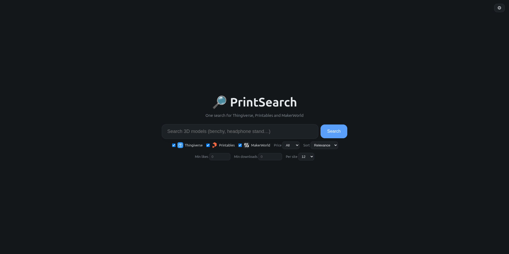
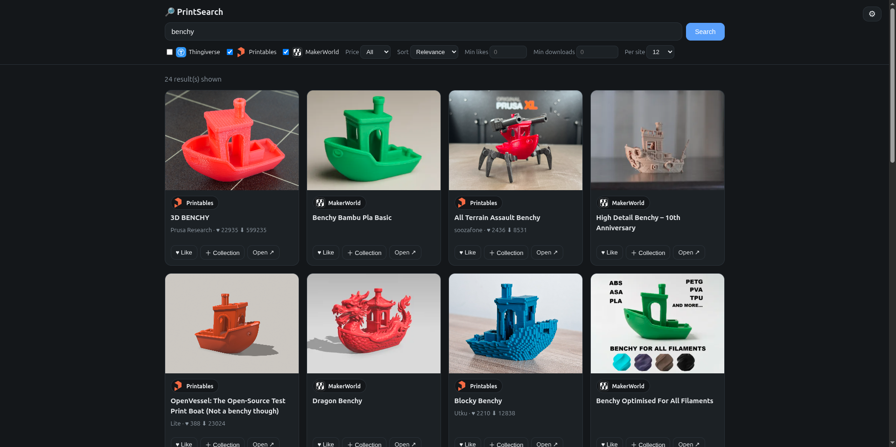

# PrintSearch
 
[English](README.md) · **Français**
 
Une seule barre de recherche pour les modèles d'impression 3D de **Thingiverse**, **Printables** et **MakerWorld**.
Une petite application Rust avec une interface web locale et un mode ligne de commande : recherchez sur les trois sites en même temps, filtrez et triez les résultats, likez un modèle ou ajoutez-le à une collection, et retrouvez vos recherches récentes. Ce code a été écrit par Claude afin de garantir une transparence totale ; je n'aurais jamais pu le faire tout seul : cela m'aurait pris trop de temps et je n'ai pas les connaissances nécessaires.
 

 
> **Non affilié à Thingiverse, Printables ni MakerWorld.** Les noms et logos appartiennent à leurs propriétaires et ne servent qu'à identifier chaque source. Voir [Limites et mentions légales](#limites-et-mentions-légales).
 
<!-- Ajoutez une capture d'écran ici :  -->
 
## Fonctionnalités
 
- Recherche en parallèle sur **Thingiverse, Printables et MakerWorld** ; les résultats sont entrelacés par site.
- Filtres : **sites, prix (gratuit / payant), tri (pertinence / likes / téléchargements), likes minimum, téléchargements minimum, résultats par site**. Changer un filtre relance la recherche automatiquement.
- **Charger plus de résultats** (pagination) et petit cache pour que les recherches répétées soient rapides.
- **Like** et **ajout à une collection** depuis les cartes de résultats (voir [fonctionnalités par site](#fonctionnalités-par-site)).
- **Historique de recherche** sous la barre de recherche (désactivable) et **choix de la langue** (anglais par défaut ; français et allemand disponibles).
- Local par défaut : le serveur n'écoute que sur `127.0.0.1` et refuse les requêtes qui ne viennent pas de `localhost:8787` (protection contre les pages web malveillantes) ; vos jetons ne quittent pas votre ordinateur. Voir [Accéder depuis une autre machine](#accéder-depuis-une-autre-machine-facultatif) pour modifier cela.
- **Vérification des mises à jour** auprès de ce dépôt GitHub (Paramètres, ligne de commande, et une discrète notification au démarrage que vous pouvez désactiver). Rien n'est téléchargé ni installé automatiquement.
- Utilisable aussi en **ligne de commande**.
## Prérequis
 
| Quoi | Pourquoi |
|---|---|
| [Rust](https://rustup.rs) (stable) | pour compiler depuis les sources |
| Un **navigateur basé sur Chromium** : Chrome, **Edge**, Brave, Vivaldi ou Chromium | MakerWorld n'a pas d'API publique exploitable : il est lu avec un navigateur sans interface. Thingiverse s'en sert en repli quand vous n'avez pas de jeton. **Windows est livré avec Edge**, il n'y a donc en général rien à installer. Firefox et Safari ne sont pas pris en charge. Vous choisissez lequel dans ⚙ Paramètres. |
| `rustfmt` (inclus dans une installation `rustup` normale) | nécessaire pour compiler la dépendance `headless_chrome` ; si Rust a été installé avec le profil *minimal*, lancez `rustup component add rustfmt` |
| Windows uniquement : *Visual Studio Build Tools* (« Desktop development with C++ ») | requis par Rust sous Windows |
 
Pas besoin d'OpenSSL (le projet utilise `rustls`).
 
## Installation
 
### Depuis les sources (Linux, macOS, Windows)
 
```bash
git clone https://github.com/Print-lab/PrintSearch.git
cd PrintSearch
cargo build --release
```
 
Le binaire est `target/release/printsearch` (`target\release\printsearch.exe` sous Windows). L'interface web et les icônes y sont intégrées : un seul fichier.
 
### Paquet Debian / Ubuntu (`.deb`)
 
```bash
cargo install cargo-deb
cargo deb
sudo apt install ./target/debian/printsearch_*_amd64.deb
```
 
Le paquet *recommande* un navigateur basé sur Chromium (Chromium, Chrome, Edge ou Brave), donc `apt` proposera d'en installer un. Après l'installation, « PrintSearch » apparaît dans le menu des applications et la commande `printsearch` est disponible dans le terminal. Avant de distribuer le paquet, renseignez `maintainer` dans `Cargo.toml`.
 
### Serveur Linux sans écran (systemd)

PrintSearch fonctionne très bien sur un serveur sans écran. Paquets nécessaires (Debian / Ubuntu) :

```bash
sudo apt install -y git curl build-essential chromium   # Ubuntu : chromium-browser
```

- `git`, `curl`, `build-essential` (compilateur C et éditeur de liens) : pour récupérer et compiler les sources.
- Un navigateur basé sur Chromium, utilisé sans fenêtre en arrière-plan. Le paquet s'appelle `chromium` sous Debian et `chromium-browser` sous Ubuntu (qui peut installer un snap) ; Google Chrome, Brave ou Edge, depuis leurs propres paquets `.deb`, conviennent aussi. Si aucun n'est détecté, choisissez-en un avec `printsearch browser <nom ou /chemin/du/navigateur>`.
- Rust (stable) via [rustup](https://rustup.rs/) (`curl --proto '=https' --tlsv1.2 -sSf https://sh.rustup.rs | sh`, puis `source "$HOME/.cargo/env"`). `rustfmt` est inclus dans le profil par défaut.

Compilez, puis lancez `printsearch serve` (et non `printsearch` seul, qui essaie d'ouvrir une fenêtre de navigateur) :

```bash
git clone https://github.com/Print-lab/PrintSearch.git
cd PrintSearch/printsearch
cargo build --release
./target/release/printsearch serve
```

Pour qu'il continue de tourner après la déconnexion et démarre au boot, créez `/etc/systemd/system/printsearch.service` (adaptez `User` et les chemins) :

```ini
[Unit]
Description=PrintSearch
After=network-online.target
Wants=network-online.target

[Service]
Type=simple
User=votreutilisateur
WorkingDirectory=/opt/PrintSearch/printsearch
ExecStart=/opt/PrintSearch/printsearch/target/release/printsearch serve
# Facultatif, pour y accéder depuis votre réseau (voir « Accéder depuis une autre machine ») :
# Environment=PRINTSEARCH_BIND=192.168.1.10
Restart=on-failure
RestartSec=5

[Install]
WantedBy=multi-user.target
```

```bash
sudo systemctl daemon-reload
sudo systemctl enable --now printsearch
journalctl -u printsearch -f          # journaux
sudo ss -tlnp | grep 8787             # vérifier que le port est à l'écoute
```

Lancez le service avec l'utilisateur dont le dossier personnel contient la configuration (`~/.config/printsearch/`), pour que les jetons enregistrés soient retrouvés. Après une recompilation, exécutez `sudo systemctl restart printsearch`.

### Exécutable Windows
 
L'`.exe` embarque l'icône de l'application. 
Compilez sous Windows avec `cargo build --release`, puis copiez `target\release\printsearch.exe` où vous voulez. Une fenêtre de console reste ouverte pendant l'utilisation : la fermer arrête le serveur. SmartScreen ou le pare-feu peuvent afficher une alerte au premier lancement (le serveur n'écoute qu'en local, vous pouvez autoriser).
 
### Compiler l'`.exe` Windows depuis Linux
 
```bash
sudo apt install mingw-w64
rustup target add x86_64-pc-windows-gnu
cargo build --release --target x86_64-pc-windows-gnu
```
 
L'icône est intégrée avec `windres` (fourni par `mingw-w64`) ; s'il manque, la compilation réussit quand même, simplement sans icône (un avertissement s'affiche).
 
## Mise à jour
 
**⚙ Paramètres → Mises à jour → Rechercher des mises à jour** (ou `printsearch update`) compare votre version à la dernière version publiée sur GitHub. Par défaut, l'application vérifie aussi une fois au démarrage et affiche une petite notification si une version plus récente existe ; décochez *Vérifier automatiquement au démarrage* pour le désactiver. **Rien n'est téléchargé ni installé à votre place** ; pour mettre à jour :
 
- **Depuis les sources :** `git pull`, puis `cargo build --release`.
- **Debian / Ubuntu :** téléchargez le nouveau `.deb` depuis la [page des Releases](https://github.com/Print-lab/PrintSearch/releases) et lancez `sudo apt install ./printsearch_*_amd64.deb`.
- **Windows :** remplacez `printsearch.exe` par le nouveau.
La vérification ne contacte que GitHub (`api.github.com`, ou `github.com` si la limite de requêtes de l'API est atteinte) et n'envoie rien d'autre qu'une requête standard.
 
## Utilisation
 
### Interface web
 

 
Lancez `printsearch` sans argument : il démarre le serveur local et ouvre votre navigateur sur **http://localhost:8787**.
 
```bash
printsearch            # démarre le serveur et ouvre le navigateur
printsearch serve      # démarre le serveur seulement (ajoutez --open pour ouvrir le navigateur)
```
 
Tapez une recherche et validez avec Entrée. Les filtres sont sous la barre de recherche ; le bouton ⚙ (en haut à droite) ouvre la page **Paramètres**.
 
### Ligne de commande
 
```bash
printsearch search "benchy"
printsearch search "support casque" --sites thingiverse,printables -l 5
printsearch search "vase" --price free --sort likes --min-likes 100 --page 2
 
printsearch login thingiverse                      # OAuth (voir plus bas)
printsearch login printables --token <JETON>
printsearch like thingiverse 763622
printsearch collect thingiverse <ID_COLLECTION> 763622
 
printsearch update                                 # vérifie sur GitHub s'il existe une version plus récente
printsearch --version
```
 
`-l/--limit` est le nombre de résultats *par site* et *par page* ; `--page` commence à 1.
 
### Choisir le navigateur utilisé pour les recherches
 
⚙ **Paramètres → Navigateur utilisé pour les recherches** : *Automatique* (le premier trouvé, dans l'ordre Chrome, Edge, Brave, Vivaldi, Chromium), un navigateur détecté, ou un **chemin personnalisé** vers n'importe quel exécutable basé sur Chromium. En ligne de commande :
 
```bash
printsearch browser                 # liste les navigateurs détectés et le choix actuel
printsearch browser edge            # chrome | edge | brave | vivaldi | chromium | auto | /chemin/du/navigateur
```
 
Le navigateur tourne en arrière-plan (sans fenêtre), images désactivées pour aller plus vite ; votre navigation personnelle n'est pas touchée.
 
### Accéder depuis une autre machine (facultatif)

Par défaut, le serveur n'écoute que sur `127.0.0.1`. Pour y accéder depuis une autre machine (par exemple un serveur sans écran), indiquez l'adresse d'écoute **avant** de le lancer :

```bash
PRINTSEARCH_BIND=192.168.1.10 printsearch serve
```

Les requêtes ne sont acceptées que si leur `Host` est `localhost`, `127.0.0.1` ou l'adresse indiquée. Si vous utilisez un nom d'hôte, ou si vous écoutez sur `0.0.0.0`, listez les noms que vous saisirez dans le navigateur :

```bash
PRINTSEARCH_BIND=0.0.0.0 PRINTSEARCH_ALLOWED_HOSTS=monserveur,192.168.1.10 printsearch serve
```

Remarques : les entrées de `PRINTSEARCH_ALLOWED_HOSTS` sont des noms d'hôte ou des adresses IP sans port (en minuscules) ; le port est toujours 8787 et seul `http://` simple est accepté (pas de proxy inverse TLS). Avec une écoute sur toutes les interfaces (`0.0.0.0`), le serveur affiche quand même `http://localhost:8787` : utilisez le nom ou l'adresse IP du serveur dans votre navigateur. Tant que `PRINTSEARCH_BIND` est une adresse hors boucle locale (par exemple `0.0.0.0` ou une adresse du réseau local), un chemin de navigateur personnalisé ne peut pas être enregistré depuis l'interface web (utilisez `printsearch browser <chemin>` sur le serveur).

⚠ Il n'y a aucune authentification. Toute personne qui peut joindre cette adresse peut utiliser PrintSearch et modifier les jetons enregistrés ; ce que vous saisissez (jetons compris) transite sans chiffrement, car la connexion est en HTTP simple. Ne le faites que sur un réseau de confiance, limitez le port avec un pare-feu, ou utilisez plutôt un tunnel SSH (`ssh -L 8787:localhost:8787 utilisateur@serveur`).

## Connecter vos comptes
 
**La recherche fonctionne sans compte** sur Printables et MakerWorld. La connexion n'est utile que pour les actions sur votre compte (like, collections) et, sur Thingiverse, pour une recherche plus rapide et plus complète.
 
Tout se passe dans **⚙ Paramètres → Connexion aux sites** : chaque site a un badge d'état et un champ pour coller un jeton. Cliquez sur **Enregistrer le jeton** ; **Se déconnecter** le supprime.
 
### Thingiverse
 
Sans jeton, la recherche lit le site avec un navigateur en arrière-plan (plus lent ; sans auteur, likes ni téléchargements). Avec un jeton, elle utilise l'API officielle : rapide, avec auteur, likes et téléchargements. Un jeton est **obligatoire pour Like et les collections**.
 
**Option A, App Token (la plus simple).**
1. Connectez-vous sur <https://www.thingiverse.com/developers> et créez une app.
2. Copiez son **App Token**.
3. Collez-le dans Paramètres → Thingiverse → *Enregistrer le jeton*.
**Option B, connexion OAuth.**
1. Créez une app sur <https://www.thingiverse.com/developers> et définissez l'URI de redirection `http://localhost:8787/callback`.
2. Définissez vos identifiants **avant** de lancer l'application :
```bash
# Linux / macOS
export THINGIVERSE_CLIENT_ID="..."
export THINGIVERSE_CLIENT_SECRET="..."
printsearch serve
```
```powershell
# Windows PowerShell
$env:THINGIVERSE_CLIENT_ID="..."; $env:THINGIVERSE_CLIENT_SECRET="..."
.\printsearch.exe serve
```
3. Dans les Paramètres, un bouton **Se connecter avec Thingiverse** apparaît. Après autorisation, vous revenez sur la page Paramètres.
Le bouton OAuth n'apparaît pas quand l'application est lancée depuis un menu ou par double-clic (pas de variables d'environnement) : utilisez alors l'option A. L'équivalent en ligne de commande est `printsearch login thingiverse`.
 
Vous pouvez aussi définir la variable d'environnement `THINGIVERSE_APP_TOKEN` au lieu d'enregistrer un jeton.
 
### Printables
 
La recherche fonctionne sans connexion. Pour utiliser **Like**, collez un jeton Bearer de votre session de navigateur :
 
1. Connectez-vous sur <https://www.printables.com>.
2. Ouvrez les outils de développement (<kbd>F12</kbd>) → onglet **Réseau**, puis rechargez la page.
3. Cliquez sur une requête vers `api.printables.com` ; dans **En-têtes de requête**, copiez la valeur après `Authorization: Bearer `.
4. Collez-la dans Paramètres → Printables → *Enregistrer le jeton*.
Ces jetons **expirent** : si Like se met à échouer, recommencez. Traitez un jeton comme un mot de passe.
 
### MakerWorld
 
La recherche fonctionne sans connexion (navigateur basé sur Chromium requis). Like et collections ne sont **pas encore implémentés** pour MakerWorld ; le champ existe dans les Paramètres pour plus tard et n'a pour l'instant aucun effet.
 
### Où sont stockés les jetons
 
Dans un fichier `config.json` du dossier de configuration de l'application (typiquement `~/.config/printsearch/` sous Linux, `%APPDATA%\printsearch\printsearch\config\` sous Windows, `~/Library/Application Support/` sous macOS), avec des droits réservés au propriétaire sous Unix. La désinstallation ne le supprime pas. La **langue et l'historique de recherche** sont enregistrés à part, dans votre navigateur (`localStorage` de `localhost:8787`).
 
## Fonctionnalités par site
 
| | Thingiverse | Printables | MakerWorld |
|---|---|---|---|
| Recherche sans connexion | ✅ via un navigateur (plus lent, données limitées) | ✅ | ✅ via un navigateur (données limitées) |
| Recherche avec jeton | ✅ API officielle (rapide, données complètes) | n/a | n/a |
| Auteur / téléchargements | ✅ avec jeton | ✅ | ❌ |
| Filtre de prix | ✅ toujours gratuit | ⚠️ au mieux | ❌ inconnu |
| Like | ⚠️ avec jeton, expérimental | ⚠️ avec jeton, expérimental | ❌ |
| Ajout à une collection | ⚠️ avec jeton, expérimental | ❌ | ❌ |
 
⚠️ *Expérimental* : les points d'accès de Printables et MakerWorld sont **non officiels**, et les routes like/collection de Thingiverse ont été écrites d'après la description de l'API publique sans être vérifiées avec un vrai compte. Elles peuvent demander des ajustements. Les pull requests sont les bienvenues.
 
Quand une valeur est inconnue (par exemple les likes sur MakerWorld), les filtres « likes min / téléchargements min » n'excluent pas le modèle, et un prix inconnu est traité comme gratuit par le filtre *Gratuit*.
 
## Dépannage
 
- **« Aucun navigateur basé sur Chromium trouvé »** : installez Chrome, Edge, Brave ou Chromium, ou choisissez-en un (ou saisissez son chemin) dans ⚙ Paramètres → *Navigateur utilisé pour les recherches*. `printsearch browser` liste ce qui a été détecté.
- **« Le navigateur ne démarre pas (délai de 35 s) »** : le navigateur choisi n'est probablement pas basé sur Chromium (ou le chemin est faux). Choisissez-en un autre dans les Paramètres.
- **MakerWorld ou Thingiverse ne renvoie rien / « aucun résultat lu »** : le site affiche probablement une vérification anti-bot (par exemple une page intitulée « Just a moment… ») que le navigateur automatisé ne passe pas toujours. Pour Thingiverse, connectez-vous avec un App Token pour passer par l'API. Le bandeau d'erreur affiche le titre de la page lue, ce qui aide au diagnostic.
- **Thingiverse est lent sans jeton** : c'est le repli par navigateur ; utilisez un App Token.
- **Printables renvoie une erreur GraphQL ou rien** : l'API non officielle a peut-être changé ; ouvrez une issue avec le message.
- **Like échoue** : votre jeton a peut-être expiré ou la route a changé (voir *Fonctionnalités par site*).
- **« Address already in use »** : le port **8787** est fixe (la redirection OAuth de Thingiverse en dépend). Fermez l'autre instance.
- **« limite de requêtes GitHub atteinte »** (vérification des mises à jour) : GitHub limite les appels anonymes à son API par adresse IP. L'application se rabat alors sur la page publique des releases ; si les deux échouent, réessayez plus tard.
- **« invalid peer certificate » / erreurs TLS** derrière un proxy d'entreprise ou un antivirus qui inspecte le HTTPS : l'application utilise le magasin de certificats du système, installez-y le certificat racine de votre organisation.
## Limites et mentions légales
 
- MakerWorld et Printables sont consultés par des moyens **non officiels** (un navigateur sans interface et un point d'accès GraphQL non documenté). Ceux-ci peuvent changer ou être bloqués à tout moment, et leurs conditions d'utilisation peuvent restreindre l'accès automatisé. Utilisez PrintSearch pour un **usage personnel, avec un volume de requêtes raisonnable**, et consultez les conditions de chaque site. Vous êtes responsable de votre usage.
- Aucune affiliation ni approbation de la part de Thingiverse (MakerBot/UltiMaker), Printables (Prusa Research) ou MakerWorld (Bambu Lab). Les marques et logos appartiennent à leurs propriétaires.
- Les résultats, miniatures et modèles appartiennent à leurs auteurs ; respectez toujours la licence de chaque modèle.
## Structure du projet
 
```
src/main.rs            CLI (clap) et point d'entrée
src/server.rs          serveur web local (axum) + API JSON
src/search.rs          recherche multi-sites, fusion, filtres, tri
src/browser.rs         lecteur de pages sans interface (détection, instance partagée, cache)
src/providers/         un fichier par site (Thingiverse, Printables, MakerWorld)
src/config.rs          stockage des jetons
web/index.html         tout le front-end (intégré au binaire)
web/icons/             icônes des sites (à remplacer puis recompiler)
packaging/             lanceur .desktop et icône pour le .deb
```
 
Ajouter un site, c'est ajouter dans `src/providers/` un fichier qui implémente le trait `Provider`.
 
## Historique des versions
 
Voir [CHANGELOG.fr.md](CHANGELOG.fr.md).
 
## Contribuer
 
Les [issues](https://github.com/Print-lab/PrintSearch/issues) et pull requests sont bienvenues, en particulier pour vérifier ou corriger les points d'accès expérimentaux, ajouter des sites et des traductions (l'objet `I18N` dans `web/index.html`).
 
## Licence
 
PrintSearch est un logiciel libre, publié sous licence **GNU General Public License v3.0** (GPL-3.0). Voir le fichier [LICENSE](LICENSE).
 
