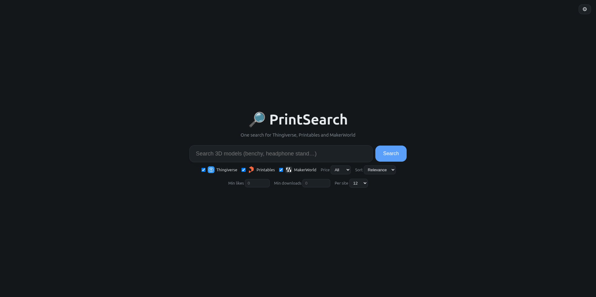
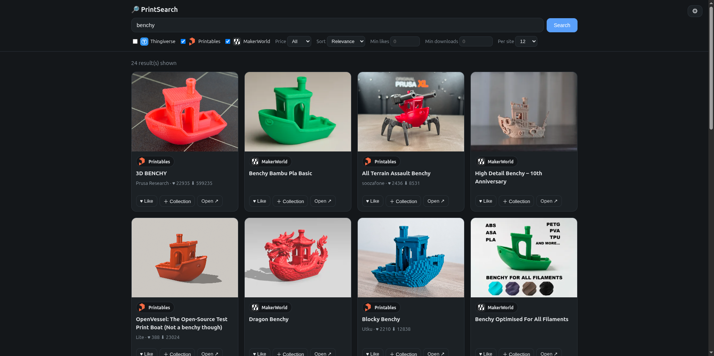

# PrintSearch

**English** · [Français](README.fr.md)

One search box for 3D-printing models on **Thingiverse**, **Printables**, **MakerWorld**, **Thangs**, **Cults** and **MyMiniFactory**.
A small Rust application with a local web interface and a command-line mode: search the six sites at once, filter and sort the results, like a model or add it to a collection, and keep your recent searches. This was coded by Claude to ensure complete transparency; I could never have done this on my own—it would have taken me too long, and I don't have enough knowledge.



> **Not affiliated with Thingiverse, Printables, MakerWorld, Thangs, Cults or MyMiniFactory.** Names and logos belong to their respective owners and are used only to identify each source. See [Limitations & legal notes](#limitations--legal-notes).

<!-- Add a screenshot here:  -->

## Features

- Search **Thingiverse, Printables, MakerWorld, Thangs, Cults and MyMiniFactory** in parallel; results are interleaved by site and appear as soon as each site answers (a slow site never delays the others).
- Filters: **sites, price (free / paid), sort (relevance / likes / downloads), minimum likes, minimum downloads, results per site**. Changing a filter re-runs the search automatically.
- **Load more results** pagination, with a short-lived cache so repeated searches are fast.
- **Like** and **add to collection** from the result cards (see [feature support](#feature-support)).
- **Search history** under the search bar (can be turned off) and a **language setting** (English by default; French and German available).
- Local only: the server listens on `127.0.0.1` and refuses requests that do not come from `localhost:8787` (protection against malicious web pages); your tokens never leave your computer.
- **Runs in the background, without a terminal window:** a **tray icon** (Windows taskbar / Linux notification area) opens the interface, the console or quits the app.
- A built-in **console** (⚙ Settings → Advanced settings) that accepts the same commands as the terminal, and a **`logs` command** to display or export the application log for bug reports.
- **Update check** against this GitHub repository (Settings, command line, and a discreet notice at startup that you can turn off). Nothing is downloaded or installed automatically.
- Also usable from the **command line**.

## Requirements

| What | Why |
|---|---|
| [Rust](https://rustup.rs) (stable) | to build from source |
| A **Chromium-based browser**: Chrome, **Edge**, Brave, Vivaldi or Chromium | MakerWorld and Thangs have no usable public API, so they are read with a headless browser. Thingiverse uses it as a fallback when you have no token. **Windows already ships with Edge**, so there is usually nothing to install. Firefox and Safari are not supported. You choose which one in ⚙ Settings. |
| `rustfmt` (included in a normal `rustup` install) | needed to build the `headless_chrome` dependency; if you installed Rust with the *minimal* profile, run `rustup component add rustfmt` |
| Windows only: *Visual Studio Build Tools* ("Desktop development with C++") | required by Rust on Windows |

No OpenSSL needed (the project uses `rustls`).

## Installation

### From source (Linux, macOS, Windows)

```bash
git clone https://github.com/Print-lab/PrintSearch.git
cd PrintSearch
cargo build --release
```

The binary is `target/release/printsearch` (`target\release\printsearch.exe` on Windows). The web interface and the icons are embedded in it: it is a single file.

### Debian / Ubuntu package (`.deb`)

```bash
cargo install cargo-deb
cargo deb
sudo apt install ./target/debian/printsearch_*_amd64.deb
```

A Chromium-based browser (Chromium, Chrome, Edge or Brave) is *recommended* by the package, so `apt` will offer to install one. After installation, "PrintSearch" appears in your application menu and `printsearch` is available in the terminal. Before distributing the package, fill in `maintainer` in `Cargo.toml`.

### Windows executable

The `.exe` embeds the application icon. 
Build on Windows with `cargo build --release`, then copy `target\release\printsearch.exe` anywhere. A console window stays open while the app runs: closing it stops the server. Windows SmartScreen or the firewall may show a prompt on first launch (the server only listens locally, you can allow it).

### Cross-compiling the Windows `.exe` from Linux

```bash
sudo apt install mingw-w64
rustup target add x86_64-pc-windows-gnu
cargo build --release --target x86_64-pc-windows-gnu
```

The icon is embedded with `windres` (included in `mingw-w64`); if it is missing, the build still succeeds, just without the icon (a warning is printed).

## Updating

**⚙ Settings → Updates → Check for updates** (or `printsearch update`) compares your version with the latest release published on GitHub. By default the app also checks once at startup and shows a small notice if a newer version exists; untick *Check automatically at startup* to disable it. **Nothing is downloaded or installed for you**; to update:

- **From source:** `git pull`, then `cargo build --release`.
- **Debian / Ubuntu:** download the new `.deb` from the [Releases page](https://github.com/Print-lab/PrintSearch/releases) and run `sudo apt install ./printsearch_*_amd64.deb`.
- **Windows:** replace `printsearch.exe` with the new one.

The check only contacts GitHub (`api.github.com`, or `github.com` if the API rate limit is reached) and sends nothing but a standard request.

## Usage

### Web interface



Launch **PrintSearch** from your applications menu (or run `printsearch` with no argument). It starts in the background **without any terminal window**, shows its **tray icon** and opens your browser on **http://localhost:8787**. Launching it again just opens the existing instance. Started from a terminal, it **detaches by itself** and gives you your prompt back, so no terminal window has to stay open (Linux).

```bash
printsearch                 # background app + tray icon + opens the browser
printsearch serve           # same, without opening the browser (add --open to open it)
printsearch serve --foreground # stay attached to this terminal, Ctrl+C to stop
printsearch serve --no-tray # no tray icon: runs in this terminal, Ctrl+C to stop
```

Type a query, press Enter. Use the filter row under the search bar; the ⚙ button (top right) opens the **Settings** page.

### Tray icon

**Left-click** opens the interface; **right-click** shows the menu: *Open PrintSearch*, *Quit*. You can also quit from ⚙ Settings → Application, with the `quit` command, or with `printsearch quit` in a terminal.

- **Windows:** the icon may be hidden in the overflow area (the `^` arrow next to the clock); drag it onto the taskbar to keep it visible.
- **Linux:** the icon uses the StatusNotifierItem protocol, shown by KDE, XFCE, Cinnamon, MATE… On **GNOME**, install the *AppIndicator and KStatusNotifierItem Support* extension. Without a tray, PrintSearch still runs fine in the background: use the web interface, or `printsearch quit` to stop it.
- **macOS:** there is no tray icon in this version; PrintSearch runs in the terminal (`serve --no-tray` behavior).
- The menu language follows the interface language, applied at the next start.
- To build without the tray (terminal-only program): `cargo build --release --no-default-features`.

### Console and commands

**⚙ Settings → Advanced settings → Open the console** opens a terminal-like page inside the app. It runs **the same commands as the terminal**: type `help` to list them. `↑`/`↓` browse your history, `Tab` completes, `clear` clears the screen, `lang en|fr` changes the language. Commands containing a token are never kept in the history and are masked on screen and in the log.

### Command line

```bash
printsearch search "benchy"
printsearch search "headphone stand" --sites thingiverse,printables -l 5
printsearch search "vase" --price free --sort likes --min-likes 100 --page 2

printsearch login thingiverse                      # OAuth (see below)
printsearch login printables --token <TOKEN>
printsearch like thingiverse 763622
printsearch collect thingiverse <COLLECTION_ID> 763622

printsearch update                                 # check GitHub for a newer version
printsearch status                                 # version, browser, connections, log location
printsearch logs                                   # last 50 log lines (-n 200, --level warn)
printsearch logs export                            # whole log + diagnostic header -> Downloads folder
printsearch quit                                   # close the running PrintSearch
printsearch --version
```

All of these also work in the in-app console. On **Windows** the program has no console window of its own: run from a terminal it attaches to it and prints its output, but the prompt may come back before the output (use `printsearch.exe ... | more`, or PowerShell, to wait for it).

`-l/--limit` is the number of results *per site* and *per page*; `--page` starts at 1.

### Choosing the browser used for searches

⚙ **Settings → Browser used for searches**: *Automatic* (first one found, in the order Chrome, Edge, Brave, Vivaldi, Chromium), a detected browser, or a **custom path** to any Chromium-based executable. From the command line:

```bash
printsearch browser                 # lists detected browsers and the current choice
printsearch browser edge            # chrome | edge | brave | vivaldi | chromium | auto | /path/to/browser
```

The browser runs in the background (no window), with images disabled for speed; your own browsing is untouched.

## Connecting your accounts

**Searching works without any account** on Printables and MakerWorld. Connecting is only needed for actions on your account (like, collections) and, on Thingiverse, for faster and richer search.

Everything is done in **⚙ Settings → Site connections**: each site has a status badge and a field to paste a token. Click **Save token**; use **Disconnect** to remove it.

### Thingiverse

Without a token, search reads the website with a browser running in the background (slower; no author, likes or downloads). With a token it uses the official API: fast, with author, likes and downloads. A token is **required for Like and collections**.

**Option A, App Token (simplest).**
1. Sign in at <https://www.thingiverse.com/developers> and create an app.
2. Copy its **App Token**.
3. Paste it in Settings → Thingiverse → *Save token*.

**Option B, OAuth login.**
1. Create an app at <https://www.thingiverse.com/developers> and set the redirect URI to `http://localhost:8787/callback`.
2. Set your credentials **before** starting the app:

   ```bash
   # Linux / macOS
   export THINGIVERSE_CLIENT_ID="..."
   export THINGIVERSE_CLIENT_SECRET="..."
   printsearch serve
   ```
   ```powershell
   # Windows PowerShell
   $env:THINGIVERSE_CLIENT_ID="..."; $env:THINGIVERSE_CLIENT_SECRET="..."
   .\printsearch.exe serve
   ```
3. In Settings, a **Connect with Thingiverse** button appears. After authorizing, you come back to the Settings page.

The OAuth button does not appear when the app is launched from a menu or by double-click (no environment variables): use Option A there. The CLI equivalent is `printsearch login thingiverse`.

You can also set `THINGIVERSE_APP_TOKEN` as an environment variable instead of saving a token.

### Printables

Search works without a connection. To use **Like**, paste a Bearer token from your browser session:

1. Sign in on <https://www.printables.com>.
2. Open the developer tools (<kbd>F12</kbd>) → **Network** tab, then reload the page.
3. Click a request to `api.printables.com`; in **Request Headers**, copy the value after `Authorization: Bearer `.
4. Paste it in Settings → Printables → *Save token*.

These tokens **expire**: if Like starts failing, repeat the steps. Treat a token like a password.

### MakerWorld

Search works without a connection (needs a Chromium-based browser). Like and collections are **not implemented** for MakerWorld yet; the field exists in Settings for the future and currently has no effect.

### Cults

Cults is protected by a bot check (Cloudflare) that blocks automated browsing, so PrintSearch uses its **official API**, which needs a free key. In your Cults account, create an API key (<https://cults3d.com/en/api/keys>), then enter your Cults **username** and the **key** in **⚙ Settings → Cults**. From the command line: `printsearch login cults3d --token <username>:<api_key>`. Search only (no Like or collections). Until a key is saved, Cults is skipped and a notice above the results says so.

### MyMiniFactory

MyMiniFactory blocks automated browsing and asks applications to use its **official API**, which needs a free API key: create an application in your MyMiniFactory account (<https://www.myminifactory.com/pages/for-developers>) and paste its key in **⚙ Settings → MyMiniFactory** (or `printsearch login myminifactory --token <api_key>`). Search only. **This integration could not be tested with a real key when it was written**: if you get an error, the message shown is the API's own answer; please report it in an issue so that it can be fixed.

### Where tokens are stored

In a `config.json` inside the application's configuration folder (typically `~/.config/printsearch/` on Linux, `%APPDATA%\printsearch\printsearch\config\` on Windows, `~/Library/Application Support/` on macOS), with owner-only permissions on Unix. Uninstalling does not delete it. **Language and search history** are stored separately, in your browser (`localStorage` for `localhost:8787`).

## Running on a server without a screen (Linux)

PrintSearch can run on a headless Linux machine (a home server, a Raspberry Pi…) and be used from other computers of your network.

1. Install the `.deb` (or copy the binary) and a Chromium-based browser (`sudo apt install chromium`): MakerWorld, Thangs and Thingiverse without a token need it.
2. Run it without a tray icon: `printsearch serve --no-tray`.
3. To reach it from other computers, tell it where to listen and which host names the clients use:

   ```bash
   PRINTSEARCH_BIND=0.0.0.0 PRINTSEARCH_ALLOWED_HOSTS=printsearch.lan,192.168.1.20 printsearch serve --no-tray
   ```

   Then open `http://printsearch.lan:8787` (or the IP address) from another computer. `PRINTSEARCH_BIND` is an IP address (default `127.0.0.1`: this computer only; the port is always 8787). `PRINTSEARCH_ALLOWED_HOSTS` lists, comma-separated, the host names and addresses typed in the clients' browsers; a request with any other `Host` or `Origin` is refused.

**What other computers can do.** There is no authentication, so when the server listens beyond its own computer, **clients on other computers can only search**. Everything that acts on your accounts or administers the app stays reserved to the computer running PrintSearch: saving tokens, Like and collections, the browser choice, the console, the logs and *Quit*. Do that part on the server itself (`printsearch login …`, `printsearch browser …`) or through an SSH tunnel (`ssh -L 8787:localhost:8787 server`, then open `http://localhost:8787`: through the tunnel you count as local and have everything). Do **not** put a reverse proxy running on the same machine in front of PrintSearch without authentication: its requests would look local. Only expose it on a network you trust, and never forward port 8787 to the Internet. The Thingiverse OAuth login only works on the server itself (its return address is `localhost`): use an App Token there.

A minimal systemd service (`/etc/systemd/system/printsearch.service`):

```ini
[Unit]
Description=PrintSearch
After=network-online.target

[Service]
User=printsearch
ExecStart=/usr/bin/printsearch serve --no-tray
Environment=PRINTSEARCH_BIND=0.0.0.0
Environment=PRINTSEARCH_ALLOWED_HOSTS=printsearch.lan,192.168.1.20
Restart=on-failure

[Install]
WantedBy=multi-user.target
```

Create the user first (`sudo useradd -m printsearch`), then `sudo systemctl enable --now printsearch`. The log is in that user's `~/.local/share/printsearch/logs/` (`sudo -u printsearch printsearch logs`).

## Logs and bug reports

PrintSearch keeps a log of what it does (searches, errors, browser start-up, updates). It **never contains your tokens**, but it does contain your search terms and stays on your computer. Location: `~/.local/share/printsearch/logs/` on Linux, `%LOCALAPPDATA%\printsearch\printsearch\data\logs\` on Windows (`printsearch logs path` prints it). It is limited to about 2 MB (one rotation).

```bash
printsearch logs                  # last 50 lines
printsearch logs -n 200 --level warn
printsearch logs export           # file in your Downloads folder, with a diagnostic header
printsearch logs export C:\temp\log.txt
printsearch logs clear
```

In the app, ⚙ Settings → Advanced settings → **Download logs** (or the button in the console) saves the same file. Attach it to your bug report (read it first: it contains your searches).

## Feature support

| | Thingiverse | Printables | MakerWorld | Thangs | Cults | MyMiniFactory |
|---|---|---|---|---|---|---|
| Search without login | ✅ via a browser (slower, limited data) | ✅ | ✅ via a browser (limited data) | ✅ via a browser (limited data) | ❌ free API key needed | ❌ free API key needed |
| Search with token | ✅ official API (fast, full data) | n/a | n/a | n/a | ✅ official API (username + API key) | ⚠️ official API (API key), untested |
| Author / likes / downloads | ✅ with token | ✅ | ❌ | ❌ | ✅ | ⚠️ best effort |
| Price filter | ✅ always free | ⚠️ best effort | ❌ unknown | ❌ unknown | ✅ | ❌ unknown |
| Like | ⚠️ with token, experimental | ⚠️ with token, experimental | ❌ | ❌ | ❌ | ❌ |
| Add to collection | ⚠️ with token, experimental | ❌ | ❌ | ❌ | ❌ | ❌ |

**Thangs** is searched without an account: PrintSearch reads its results page with the background browser and shows the title, picture and link of each model; its cards only have the *Open* link. **Cults** and **MyMiniFactory** block automated browsing and ask applications to use their official APIs, so they are searched **only once you add a free API key** in Settings (see *Connecting your accounts*); until then they are skipped and a notice explains why. Like and collections are not available for these three sites.

⚠️ *Experimental*: Printables and MakerWorld endpoints are **not official**, and the Thingiverse like/collection routes were written from the public API description without being verified against a live account. They may need adjusting. Pull requests welcome.

When a value is unknown (for example likes on MakerWorld), the "min likes / min downloads" filters do not exclude the model, and an unknown price is treated as free by the *Free* filter.

## Troubleshooting

- **"No Chromium-based browser found"**: install Chrome, Edge, Brave or Chromium, or pick one (or type its path) in ⚙ Settings → *Browser used for searches*. `printsearch browser` lists what was detected.
- **"The browser did not start within 35 s"**: the browser you selected is probably not Chromium-based (or the path is wrong). Pick another one in Settings.
- **MakerWorld or Thingiverse returns nothing / "no result read"**: the site probably shows an anti-bot check (e.g. a page titled "Just a moment…"), which an automated browser cannot always pass. For Thingiverse, connect with an App Token to use the API instead. The error banner shows the title of the page that was read, which helps to diagnose.
- **Thingiverse is slow without a token**: that is the browser fallback; use an App Token.
- **Printables returns a GraphQL error or nothing**: the unofficial API may have changed; open an issue with the message.
- **Like fails**: your token may have expired or the route may have changed (see *Feature support*).
- **Nothing visible when launching**: PrintSearch runs in the background; look for the tray icon, or open <http://localhost:8787>. If the port is already used by another program, `printsearch logs` explains it.
- **Cults / MyMiniFactory are not searched**: they need a free API key (⚙ Settings). A notice above the results says so. If Cults answers *refused the credentials*, check your username and API key (the key is not your password).
- **No tray icon on GNOME**: install the *AppIndicator* extension (see *Tray icon*). Until then use the web interface and `printsearch quit`.
- **Port 8787 in use** by another program: the port is fixed (the Thingiverse OAuth redirect depends on it). Close that program. (Launching PrintSearch twice is fine: the second launch simply opens the first.)
- **"GitHub rate limit reached"** (update check): GitHub limits anonymous API calls per IP address. The app then falls back to reading the public releases page; if both fail, try again later.
- **"invalid peer certificate" / TLS errors** behind a company proxy or an antivirus that inspects HTTPS: the app uses your system's certificate store, so install your organization's root certificate there.
- **Error messages** coming from the server (red banner) are in English; the interface itself is translated into English, French and German.

## Limitations & legal notes

- MakerWorld, Thangs and Printables are accessed through **unofficial** means (a headless browser reading their pages, and an undocumented GraphQL endpoint for Printables). Cults and MyMiniFactory are accessed through their **official APIs**, with your own key. The search address and link shape of Thangs, and the MyMiniFactory API fields, could not be checked against a live session when they were added. These can change or be blocked at any time, and their terms of service may restrict automated access. Use PrintSearch for **personal use, at a reasonable request rate**, and check each site's terms. You are responsible for how you use it.
- No affiliation with, or endorsement by, Thingiverse (MakerBot/UltiMaker), Printables (Prusa Research) or MakerWorld (Bambu Lab). Trademarks and logos are the property of their owners.
- Results, thumbnails and models belong to their authors; always respect each model's license.

## Project layout

```
src/main.rs            CLI (clap) and entry point
src/app.rs             lifecycle: single instance, server thread, tray icon, clean shutdown
src/tray.rs            tray / notification-area icon (Windows, Linux)
src/commands.rs        commands shared by the terminal and the in-app console
src/log.rs             log file, rotation, export
src/server.rs          local web server (axum) + JSON API
src/search.rs          multi-site search, merging, filters, sorting
src/browser.rs         headless browser reader (detection, single shared instance, cache)
src/providers/         one file per site (Thingiverse, Printables, MakerWorld) + web.rs (Thangs, Cults, MyMiniFactory)
src/config.rs          token storage
web/index.html         the whole front-end (embedded in the binary)
web/icons/             site icons (replace to change them, then rebuild)
packaging/             .desktop launcher and icon for the .deb
```

Adding a site means adding a file implementing the `Provider` trait in `src/providers/`.

## Changelog

See [CHANGELOG.md](CHANGELOG.md).

**Credits:** the German translation, the idea of the `PRINTSEARCH_BIND` / `PRINTSEARCH_ALLOWED_HOSTS` settings, the headless-server documentation and the English comments and messages come from a contribution by [@Leviathan09](https://github.com/Leviathan09) ([#1](https://github.com/Print-lab/PrintSearch/issues/1), [#2](https://github.com/Print-lab/PrintSearch/pull/2)), adapted to this version.

## Contributing

[Issues](https://github.com/Print-lab/PrintSearch/issues) and pull requests are welcome, especially for verifying or fixing the experimental endpoints, adding sites, and translations (the `I18N` object in `web/index.html`).

## License

PrintSearch is free software, released under the **GNU General Public License v3.0** (GPL-3.0). See the [LICENSE](LICENSE) file.
